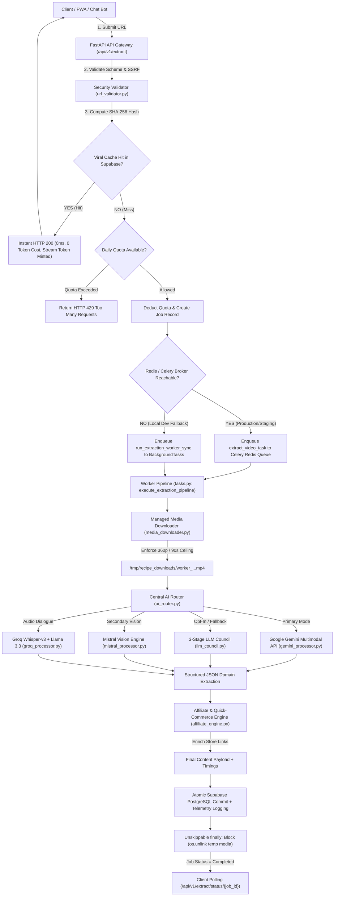
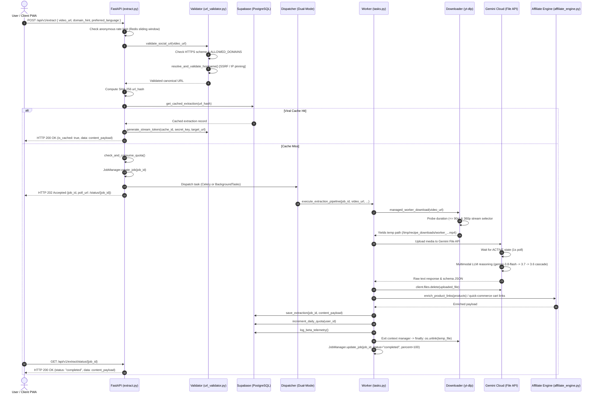
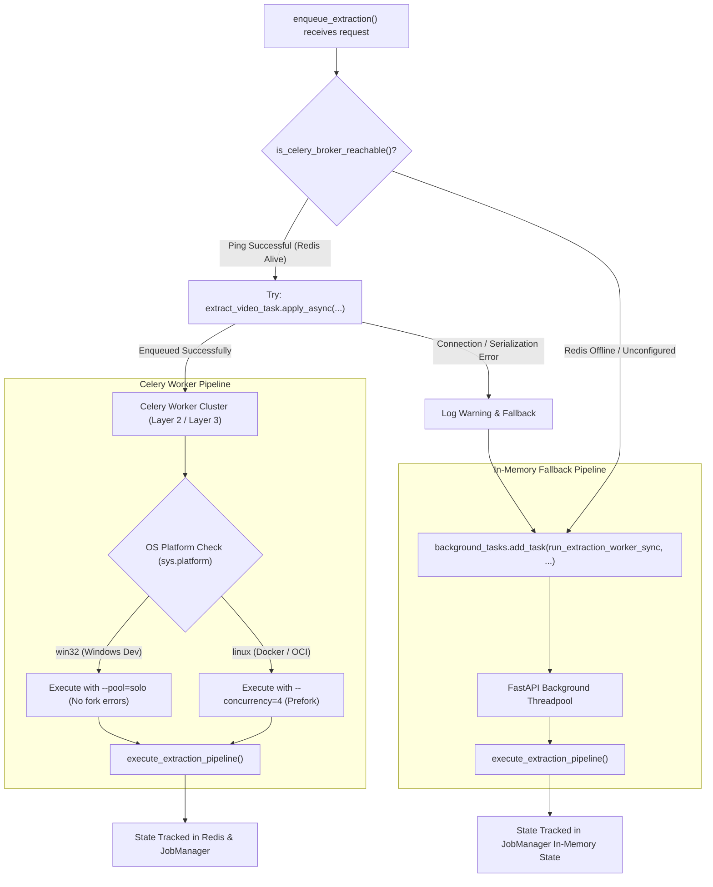
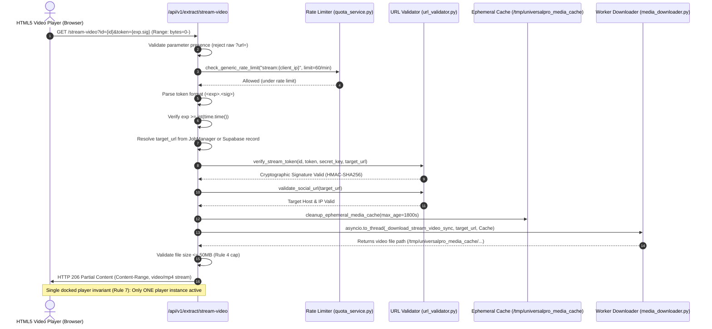
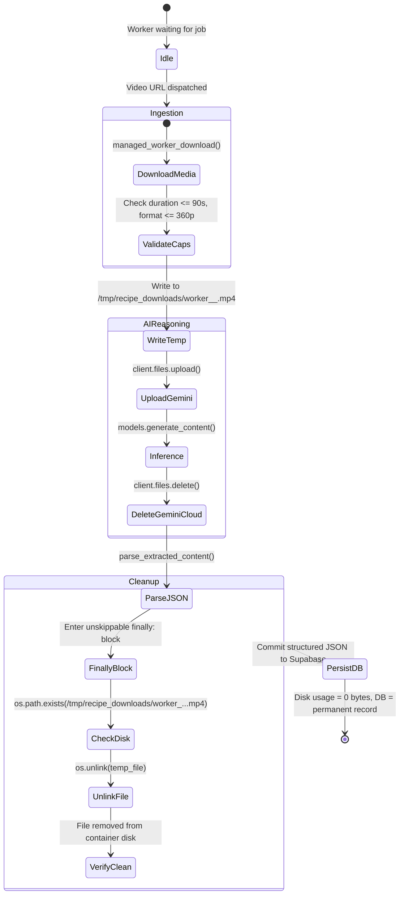
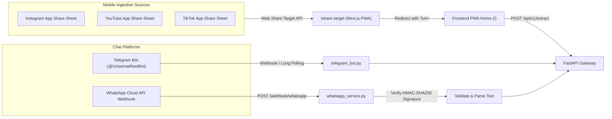

# 🧭 Universal Pro AI — Execution Flow Mapping & System Call Hierarchy

---

## 1. DOCUMENT CONTROL

* **Document Title**: Execution Flow Mapping & System Call Hierarchy
* **File Path**: `docs/architecture/FLOW.md`
* **Governing Rule**: AGENTS.md Rule 23 (*Execution Flow Mapping & System Call Hierarchy*)
* **Document Status**: Active / Reconciled Baseline `[VERIFIED IN CURRENT REPOSITORY]`
* **Initial Baseline Date**: October 16, 2026
* **Target Audience**: Core Engineers, System Architects, Quality Assurance, Automated Coding Agents

---

## 2. HIGH-LEVEL PIPELINE TOPOLOGY



---

## 3. CORE EXECUTION FLOWS

### 3.1 Video Extraction & Processing Pipeline

The primary extraction flow processes a user-supplied social video URL from ingestion to structured output.



#### Detailed Stage Breakdown:
1. **Request Intake & Schema Validation**:
   - `POST /api/v1/extract` receives `ExtractRequest` validated via Pydantic (`video_url`, `domain_hint`, `preferred_language`).
   - Anonymous tier IP sliding window: Rate limit enforced via Redis (`ANONYMOUS_RATE_LIMIT_PER_MINUTE = 3`).
2. **Security & SSRF Verification**:
   - `validate_social_url()` in `url_validator.py` checks protocol (`https://`), domain allowlist, executes DNS resolution with `socket.getaddrinfo`, and verifies `is_globally_routable_ip()`.
   - Maximum 3 redirect hops followed manually; each hop re-validates host and IP.
3. **Canonical Cache Lookup**:
   - Canonical URL string stripped of tracking parameters (`?igsh=...`, `?utm_source=...`).
   - SHA-256 hash computed. Supabase queried via PostgREST (`get_cached_extraction(url_hash)`).
   - If hit, signed HMAC stream token is minted, and payload is returned immediately with HTTP 200.
4. **Quota Gate & Enqueueing**:
   - On cache miss, `quota_manager.check_and_consume_quota()` decrements daily quota.
   - Job is registered in `JobManager` with UUID4 `job_id`.
   - HTTP 202 Accepted returned with `poll_url: /api/v1/extract/status/{job_id}`.
5. **Media Download (Ingestion Guardrails)**:
   - `managed_worker_download()` enters context manager.
   - `yt-dlp` fetches metadata. Duration verified $\le 90$s. Missing duration fails closed.
   - Format: `bestvideo[height<=360][ext=mp4]+bestaudio[ext=m4a]/bestvideo[height<=360]+bestaudio/best[height<=360]`.
   - Stream saved to ephemeral path `/tmp/recipe_downloads/worker_<ts>_<id>.mp4`.
6. **Multimodal AI Reasoning**:
   - Video uploaded to Google Gemini File API (`client.files.upload()`).
   - Polled until state is `ACTIVE`.
   - Primary model cascade executed: `gemini-3.8-flash` $\rightarrow$ `gemini-3.7-flash` $\rightarrow$ `gemini-3.6-flash` $\rightarrow$ `gemini-3.5-flash`.
   - On HTTP 503/429/timeout, fast failover switches to the next model tier.
   - File deleted from Gemini Cloud via `client.files.delete()`.
   - `parse_extracted_content()` parses raw JSON into structured metadata (`title`, `category`, `summary`, `details`, `instructions`, `products`, `resources`).
7. **Monetization & Quick-Commerce Enrichment**:
   - `affiliate_engine.enrich_product_links()` injects Amazon Associates (`tag=manasdas11155-21`), EarnKaro (`r=5608766`), and 10-minute quick-commerce search links (Blinkit, Zepto, Instamart, JioMart).
8. **Persistence & Cleanup**:
   - Structured payload committed to Supabase `extractions` table.
   - Telemetry logged (`log_beta_telemetry`).
   - Context manager exits: `finally:` block unlinks `/tmp/recipe_downloads/worker_...mp4`.
   - `JobManager` status updated to `completed` (100%).

---

### 3.2 Dual-Mode Dispatcher Flow

Ensures zero dependency friction in local development while maintaining horizontally scalable distributed queues in production.



#### Dispatcher Invariants:
* **Broker Probing**: `is_celery_broker_reachable()` performs a non-blocking TCP socket check against `REDIS_URL` with a 1-second timeout.
* **Windows Multi-Processing Guard**: When running `scripts/run_worker.py` on Windows, `--pool=solo` is forced. Celery pre-fork (`fork()`) is strictly reserved for Linux container runtimes.
* **Stateless Web Layer**: Neither path retains media files or extraction state in web process memory. Completed state is written to Supabase and polled via `job_id`.

---

### 3.3 Security & Video Stream Proxy Flow

The `/stream-video` endpoint allows in-page HTML5 video playback without exposing raw upstream URLs or triggering CORS/media player collisions.



#### Stream Proxy Security Controls:
1. **Query Hygiene**: Client-supplied `?url=` parameters are strictly rejected (`HTTP 400`). Only server-side resolved URLs bound to the signed token are streamed.
2. **Token Structure**: Token consists of `<expiration_timestamp>.<hmac_signature>`. Expired tokens fail before cryptographic verification.
3. **Payload Binding**: The HMAC-SHA256 signature binds the extraction `id`, `expiration`, and server-resolved `media_url` using `SECRET_KEY`.
4. **Range Requests**: Supports HTTP Range headers (`bytes=0-`) to enable scrubbing and instant playback on iOS Safari and mobile Chrome.
5. **Ephemeral Cache TTL**: Media files in `/tmp/universalpro_media_cache/` are purged after 30 minutes via `cleanup_ephemeral_media_cache()`.

---

### 3.4 Storage & Ephemeral Media Cleanup Lifecycle

Enforces zero media retention and strict compliance with AGENTS.md Rules 4 and 5.



#### Cleanup Invariants:
1. **Unskippable `finally:` Guarantee**: All media downloads inside `managed_worker_download` execute within a Python context manager. Regardless of whether inference succeeds, throws an exception, or encounters a timeout, the file path is unlinked.
2. **Intermediate Artifacts**:
   - Keyframe images (`frames_<stem>/frame_*.jpg`) generated for Mistral Vision must be unlinked in a `finally:` block.
   - Audio tracks (`.mp3`) extracted for Groq Whisper must be unlinked immediately after transcription completes.
3. **Container Immutability**: No media files are ever moved or written to `/app/backend/app/services/downloads/` or any directory inside the application source tree. All temporary processing happens under `/tmp/`.

---

### 3.5 Web Share Target & Chat Ingestion Flow

Universal Pro AI supports one-tap video ingestion from native mobile apps (Instagram, TikTok, YouTube) and chat platforms.



#### Ingestion Security Invariants:
* **Web Share Target**: Receives `POST /share-target` from mobile OS share sheets and parses URL query params before client-side submission.
* **WhatsApp Signature Verification**: The WhatsApp webhook handler validates `X-Hub-Signature-256` over the **raw request payload body** using `hmac.compare_digest` *before* parsing JSON, preventing request tampering.

---

### 3.6 Six-Phase Release Lifecycle & Mandatory Two-Tier Playwright Gate Sequence

All repository changes follow six distinct operational phases with mandatory automated release gates and Product Owner checkpoints:

```mermaid
flowchart TD
    subgraph Phase1["Phase 1: Intake & Governed Planning"]
        P1A["Backlog Intake (JIRA_BACKLOG.md)"] --> P1B["Risk Assessment & Rollback Map"]
        P1B --> P1C{"Touches Protected Areas?"}
        P1C -->|Yes| P1D["Owner Checkpoint Gate (STOP)"]
        P1C -->|No| P2A
        P1D -->|Approved| P2A
    end

    subgraph Phase2["Phase 2: Dev Implementation & Local Verification"]
        P2A["Sandbox Implementation on Dev"] --> P2B["Focused Regressions (pytest / vitest)"]
        P2B --> P2C["Deterministic Mocked Playwright (test:e2e:mocked)"]
    end

    subgraph Phase3["Phase 3: Living Document Sync & Definitive Verification"]
        P2C --> P3A["Synchronize All 6 Living Documents (Rule 9/21)"]
        P3A --> P3B["Documentation Impact Assessment & ADR/FLOW Updates"]
        P3B --> P3C["Inspect Final Tree Diff"]
        P3C --> P3D["Definitive Rule 16 Pipeline (ci_check.py: tsc, lint, vitest, build, pytest)"]
        P3D --> P3E["Governed Commit ([UPA-####] ...)"]
        P3E --> P3F["Dev / PO Review Boundary Gate (STOP)"]
    end

    subgraph Phase4["Phase 4: Governed Staging Promotion"]
        P3F -->|PO Authorized| P4Pre{"Source Preflight Check (Dev Manifest @ commit SHA)"}
        P4Pre -->|FAIL / Mismatch / Unverified| P4Block["Fail-Closed Promotion Blocker (STOP)"]
        P4Pre -->|PASS (Dev evidence valid for SHA)| P4A["Prepare Promotion Branch (promotion/...)"]
        P4A --> P4B["Submit PR to staging & Validate Remote CI (ci.yml)"]
        P4B --> P4C["Owner PR Sign-Off & Merge into origin/staging"]
    end

    subgraph Phase5["Phase 5: Live Staging Deployment Verification & Release Gates"]
        P4C --> P5A["Deploy Frontend (Vercel) & Backend (OCI VM 129.225.86.241)"]
        P5A --> P5B["Verify Deployed Versions & Endpoints (verify_promotion.py --deployed)"]
        P5B --> P5C["Tier 1 Mandatory Live Staging Smoke Gate (smoke.staging.e2e.ts)"]
        P5C --> P5D{"Extraction / Worker Changed?"}
        P5D -->|Yes| P5E["Tier 2 Conditional Live Extraction Gate (ALLOW_DB_WRITES=false)"]
        P5D -->|No| P5F["Record Commit-Bound Evidence Manifest"]
        P5E --> P5F
        P5F --> P5G["Owner Staging Sign-Off in SIGN_OFF.md (STOP)"]
    end

    subgraph Phase6["Phase 6: Governed Production Release & Closeout"]
        P5G -->|Explicit Written Authorization| P6Pre{"Source Preflight Check (Staging Live Manifest @ commit SHA)"}
        P6Pre -->|FAIL / Mocked Evidence / Mismatch| P6Block["Fail-Closed Promotion Blocker (STOP)"]
        P6Pre -->|PASS (Live Staging evidence bound to SHA)| P6A["Deploy to Production (universal-pro-ai.vercel.app & OCI 140.245.214.28)"]
        P6A --> P6B["Post-Deployment Non-Destructive Live Smoke Check"]
        P6B --> P6C{"Production Smoke PASS?"}
        P6C -->|FAIL| P6D["Halt Progression, Alert Owner, Execute Bounded Rollback (Runbook 25)"]
        P6C -->|PASS| P6E["Owner Final Closeout (SIGN_OFF.md & JIRA_BACKLOG.md Released)"]
    end
```

---

## 4. SUBSYSTEM CALL HIERARCHY & DEPENDENCY MAP

| Entry Point / Route | Primary Module | Downstream Calls & Libraries | System of Record | Fallback Path |
| :--- | :--- | :--- | :--- | :--- |
| `POST /api/v1/extract` | `api/v1/extract.py` | `url_validator.py`, `supabase_client.py`, `quota_service.py` | Supabase `extractions` | `BackgroundTasks` if Redis down |
| `GET /api/v1/extract/status/{id}` | `api/v1/extract.py` | `job_manager.py`, `supabase_client.py` | In-memory `JobManager` / Supabase | Fallback to Supabase cache query |
| `GET /api/v1/extract/stream-video` | `api/v1/extract.py` | `url_validator.py`, `media_downloader.py`, `quota_service.py` | Ephemeral disk `/tmp/universalpro_media_cache` | Legacy `get_video_from_url` fallback |
| `POST /api/v1/library/{id}/export` | `api/v1/library.py` | `supabase_client.py`, `security.py` | Supabase `extractions` | In-memory `PlainTextResponse` |
| Worker Extraction Task | `workers/tasks.py` | `media_downloader.py`, `ai_router.py`, `affiliate_engine.py`, `supabase_client.py` | Supabase `extractions` | Cascade failover across Gemini Flash models |
| Gemini Multimodal Processor | `services/gemini_processor.py` | `google-genai` SDK (`client.files`, `client.models`) | In-memory metadata | Failover: 3.8 $\rightarrow$ 3.7 $\rightarrow$ 3.6 $\rightarrow$ 3.5 |
| Multi-LLM Council Consensus | `services/llm_council.py` | `gemini_processor.py`, `mistral_processor.py`, `groq_processor.py` | In-memory report | Degrades to single provider if keys missing |
| Affiliate Link Enrichment | `services/affiliate_engine.py` | `urllib.parse.quote_plus` | Immutable constants | Dynamic store link suppression by category |
| Telegram Bot Listener | `services/telegram_bot.py` | `url_validator.py`, `extract.py`, `requests` | Telegram Bot API | Error message dispatch to chat |
| WhatsApp Cloud Webhook | `services/whatsapp_service.py` | `url_validator.py`, `hmac`, `requests` | Meta Graph API | Fail-closed signature verification |
| Governance Contract Verification | `tests/test_sprint14_commerce.py` | `AGENTS.md` (line-anchored Section 9 slice), `docs/USER_MANUAL.md`, `FaqSection.tsx` | `AGENTS.md` | Explicit missing-path diagnostics |
| Mocked E2E Release Verification | `frontend/e2e/specs/app.spec.ts` | Playwright mock route fixtures, `http://localhost:3000` | In-memory Next.js test server | Fail build on regression |
| Tier 1 Live Staging Smoke Gate | `frontend/e2e/specs/smoke.staging.e2e.ts` | Vercel Staging preview origin, Vercel edge bypass cookie, backend origin (`STAGING_API_URL` / `http://129.225.86.241`), `validateNavigationResponse` | Vercel Edge Staging | Block Staging acceptance on failure (offline unit-tested; not yet run against live Staging) |
| Tier 2 Conditional Extraction E2E | `frontend/e2e/specs/staging.live.e2e.ts` | Media downloader, OCI Staging VM (`129.225.86.241`), `ALLOW_DB_WRITES=false` | Ephemeral Redis/memory JobManager | Block Staging sign-off on failure |
| Promotion Manifest Verification | `scripts/promote.py` & `scripts/verify_promotion.py` | `verify_evidence_manifest`, `validateEvidenceManifest`, commit SHA check | Commit-bound `evidence-manifest.json` | Rejects mocked evidence for staging/prod; blocks promotion on missing/mismatched SHA |
| Definitive Rule 16 CI Pipeline | `scripts/ci_check.py` | `npx tsc`, `npm run lint`, `npm test`, `npm run build`, `pytest tests/` | Immutable Rule 16 Contract | Zero-defect promotion blocker |
